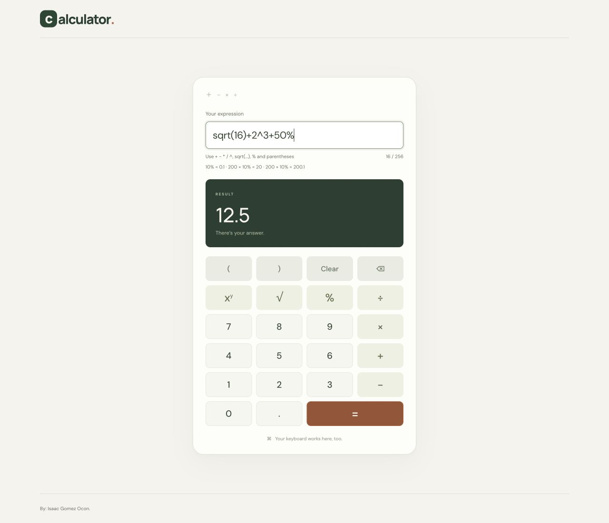

# Full-stack calculator

A React + TypeScript calculator backed by a Go REST service.

**Current status:** the Go backend evaluates expressions with addition, subtraction, multiplication, division, exponentiation (`^`), square root (`sqrt(...)`), postfix percentage (`%`), unary signs, decimals, and nested parentheses. It validates requests, returns positioned errors, and includes a health check, configurable port, and graceful shutdown. The responsive frontend supports keyboard entry, an on-screen keypad, positioned errors, loading feedback, and API failure recovery.

## Documentation

- [Implementation plan](PLAN.md): scope, architecture, milestones, testing, and delivery checklist.
- [API contract](docs/API.md): implemented endpoints, grammar, limits, and error responses.
- [Frontend review guide](docs/FRONTEND.md): UI state, interaction flows, API handling, design choices, and alternatives to review.
- [Calculator design](docs/ARCHITECTURE.md): tokenizer, parser, expression tree, and evaluator.
- [Prompt log](PROMPT_LOG.md): user prompts supplied for this app.

## Run locally

Use two terminals: one for Go and one for Vite. Frontend prerequisites are Node.js 24.14 or newer and npm; verified with Node 24.14.1 and npm 11.11.0. Dependency versions are recorded in `frontend/package-lock.json`.

### Backend

Requires Go 1.25 or newer. Tested locally with Go 1.25.4 on macOS/arm64. The backend uses only the Go standard library, so no dependency installation, database, credentials, or `.env` file is needed.

From the repository root:

```bash
cd backend
go run ./cmd/server
```

The server listens on port `8080` on all network interfaces. Override the port when needed:

```bash
PORT=9090 go run ./cmd/server
```

`PORT` must be an integer from 1 through 65535. Invalid configuration or an occupied port causes a startup error and a nonzero exit. Stop the server with Ctrl+C; it allows up to five seconds for active requests to finish. The service uses standard HTTP read/write/idle timeouts and logs startup, shutdown, and failures.

### Frontend

In another terminal, from the repository root:

```bash
cd frontend
npm ci
npm run dev
```

Open [the calculator](http://127.0.0.1:5173). Vite proxies `/api` to `http://127.0.0.1:8080`, so browser requests use the same origin. If you changed the backend port, set its target when launching Vite:

```bash
API_PROXY_TARGET=http://127.0.0.1:9090 npm run dev
```

Enter an expression and press Enter or `=`. The keypad inserts at the cursor and replaces selected text; Clear resets the input, result, and errors. Inputs are disabled while waiting, and requests time out after ten seconds. Editing clears stale output. Syntax errors focus the corresponding character, including an end-of-expression position when a token is missing.

The page contains a compact “Calculator” wordmark, a centered calculator card, and the footer credit “By: Isaac Gomez Ocon.” on both desktop and mobile. `App` renders the page shell; `Calculator` coordinates `ExpressionInput`, `ResultPanel`, and `Keypad`.

The keypad includes Power (`xʸ`), Square root (`√`), and Percentage (`%`). Its six rows follow the documented layout, with the equals button spanning two columns. Power inserts `^`; percentage inserts `%`. Square root inserts `sqrt()` with the cursor inside, or wraps selected text in `sqrt(...)`. The input help lists the syntax and explains that `200*10% = 20`, while `200+10% = 200.1`. All operations are evaluated by Go. For example, `sqrt(16)+2^3+50%` returns `12.5`.

Screenshots: [desktop](docs/screenshots/desktop.png) · [320px mobile](docs/screenshots/mobile.png).



## Try the current endpoints

Health check:

```bash
curl -i http://localhost:8080/health
```

Expected: HTTP `200`, JSON `{"status":"ok"}`.

Calculate an expression:

```bash
curl -i http://localhost:8080/api/v1/calculate \
  -H 'Content-Type: application/json' \
  -d '{"expression":"(2+3)*4"}'
```

Expected: HTTP `200`, JSON `{"result":20}`.

Precedence is respected: `2+3+5/4` returns `6.25`, while `(2+3+5)/4` returns `2.5`. A single number is also a valid expression. Multiplication must be explicit, so use `2*(3+4)`.

For `10/(3-3)`, the API returns HTTP `422`:

```json
{
  "error": {
    "code": "DIVISION_BY_ZERO",
    "message": "Cannot divide by zero.",
    "position": 2
  }
}
```

Positions are zero-based code-point offsets in the original expression. Domain errors, including `sqrt(-1)`, `0^0`, and `(-2)^0.5`, return `422 INVALID_ARGUMENT`. Syntax and schema errors return `400`; oversized bodies return `413`; unsupported Content-Type returns `415`. Unsupported methods return `405` with an `Allow` header, and unknown paths return `404`.

Requests are limited to 4096 bytes, expressions to 256 characters, and parenthesis nesting to 32. Only the exact `expression` key is accepted; unknown/duplicate fields, nulls, and trailing JSON are rejected. See the [API contract](docs/API.md) for details.

## Backend checks and coverage

From the repository root:

```bash
cd backend
go test ./... -coverprofile=coverage.out
go tool cover -func=coverage.out
go tool cover -html=coverage.out -o coverage.html
go vet ./...
```

Tests cover tokenization, tree structure, precedence, associativity, nested parentheses, unary signs, decimals, error positions, numeric guards, request validation, input limits, routing, and port configuration. Coverage files are generated locally and ignored by Git.

Verified on Go 1.25.4: `go test -race ./... -coverprofile=coverage.out`, `go vet ./...`, and the standalone build pass. Statement coverage is **89.8% overall**, **99.4% for the calculator package**, and **95.5% for HTTP**. The server entry point/lifecycle is checked separately over HTTP rather than included in unit-test coverage.

The latest five-second fuzz run completed **525,169 executions** without failures. A live test against the updated backend verified health, twelve calculations (including all new operations), seven positioned errors, and clean SIGTERM shutdown. The frontend was subsequently checked against the real backend in a browser; see frontend verification below.

To repeat the short fuzz check from `backend/`:

```bash
go test ./internal/calculator -run='^$' -fuzz=FuzzEvaluate -fuzztime=5s -parallel=2
```

To build a standalone executable from `backend/`:

```bash
go build -o bin/calculator ./cmd/server
./bin/calculator
```

## Frontend checks and build

From the repository root:

```bash
cd frontend
npm run test:coverage
npm run typecheck
npm run build
```

All **37 tests pass**, with **98.05% statement coverage**, **93.51% branch coverage**, and **100% line/function coverage** across application/client code. Coverage includes untested source files, excluding tests, test setup, and the bootstrap entry point. HTML and LCOV reports are generated in `frontend/coverage/` and ignored by Git.

Tests exercise the actual API client with controlled fetch responses: request shape, finite results, malformed responses, errors/positions, connectivity and timeout behavior. Component tests cover Enter submission, empty/overlong input (including after template insertion), pending state, Clear, keypad editing, square-root wrapping and cursor placement, exact advanced-operation requests, domain-error selection, retry, and stale-output clearing. These unit tests do not substitute for real HTTP verification.

Browser verification used Vite with the real Go backend: precedence, parentheses, division-by-zero feedback, Clear, and recovery after deliberately stopping/restarting the backend. The advanced controls were subsequently verified through real API requests for `2^3^2`, `sqrt(9)`, `200*10%`, and `sqrt(-1)`, including selection wrapping. Desktop and 320px mobile layouts were visually checked; the mobile page has no horizontal overflow and keypad buttons remain 52px tall. Screenshots are linked above. Loading and timeout behavior also have automated coverage.

`npm run build` checks TypeScript and writes the production frontend to `frontend/dist/`. Production hosting must serve those static files and route `/api` to Go on the same origin; the Vite development server is not a production deployment. Typography loads from Google Fonts with local sans-serif fallbacks.

## Remaining delivery work

Publish the repository and coverage artifacts for evaluation. The optional arithmetic operations and their frontend controls/help are implemented. Docker remains optional future work.

## Design decisions and assumptions

- Each frontend component imports its own CSS Module. Shared fonts, theme variables, resets, and accessibility utilities remain in `frontend/src/styles.css`; responsive rules live with the component they affect.

- The server entry point owns configuration, HTTP timeouts, signals, and shutdown; `internal/httpapi` constructs routes independently of a listener for testing.
- Go owns arithmetic. A separate tokenizer/parser/evaluator accepts only the documented arithmetic grammar. The parser builds a tree before arithmetic begins, so syntax errors take priority over division errors.
- One expression field supports multiple operators and parentheses. Go enforces full validation; React checks presence/length and shows server errors with positions; it never evaluates arithmetic locally.
- Binary floating-point can produce decimal rounding artifacts; the application is not intended for exact financial arithmetic.
- Calculations are stateless; no accounts or database are required.
- Advanced operations and Docker follow completion of the required functionality.

## Submission status

- Backend and frontend implementation, tests, build, and local browser integration: complete.
- Git repository: initialized locally; publication and evaluator access: pending.
- Repository URL: pending.
- Prompt record: [PROMPT_LOG.md](PROMPT_LOG.md); append prompts used in subsequent work and other AI tools.
