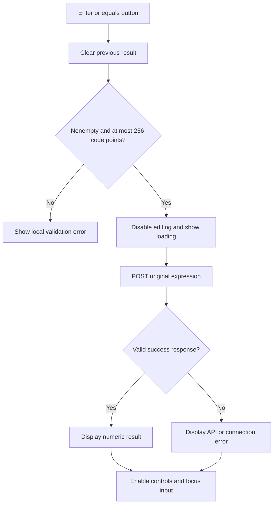

# Frontend implementation and review guide

This document explains the current implementation so its behavior and design choices can be reviewed before further changes. The React frontend is already implemented; the alternatives listed here are review options, not changes that have been made.

## Responsibility and boundaries

The frontend lets a user edit an expression, submit it, and understand the result or error. Go owns parsing, precedence, parentheses, and arithmetic. React sends the original input unchanged and never calculates a result locally.

For example, entering `2+3+5/4` sends:

```json
{"expression":"2+3+5/4"}
```

A successful response is:

```json
{"result":6.25}
```

The full request/error contract is in [API.md](API.md).

## File structure

| File | Responsibility |
| --- | --- |
| [main.tsx](../frontend/src/main.tsx) | Mounts React and imports CSS. Uses React StrictMode during development. |
| [App.tsx](../frontend/src/App.tsx) | Renders the header, main page layout, calculator, and footer. |
| [Calculator.tsx](../frontend/src/components/Calculator.tsx) | Owns expression/result/error/pending state, input focus/selection, validation, submission, and keypad editing. |
| [ExpressionInput.tsx](../frontend/src/components/ExpressionInput.tsx) | Renders the controlled expression field, label, help text, character count, and accessibility attributes. |
| [ResultPanel.tsx](../frontend/src/components/ResultPanel.tsx) | Displays result/loading/error feedback and readable error positions. |
| [Keypad.tsx](../frontend/src/components/Keypad.tsx) | Renders accessible keys, forwards editing actions, and submits the containing form through the equals button. |
| [operatorSubstitution.ts](../frontend/src/utils/operatorSubstitution.ts) | Pure helper that identifies the trailing operator range to replace during keypad editing. |
| [operatorSubstitution.test.ts](../frontend/src/utils/operatorSubstitution.test.ts) | Tests the substitution matrix, negative operands, and boundaries of the editing rule. |
| [calculator.ts](../frontend/src/api/calculator.ts) | Makes HTTP requests, validates responses, translates errors, and enforces a timeout. |
| [styles.css](../frontend/src/styles.css) | Shared font imports, CSS variables, resets, focus/disabled behavior, reduced-motion support, and `sr-only`. |
| [App.module.css](../frontend/src/App.module.css) | Page shell, centering, header/wordmark/footer, and their responsive rules. |
| [Calculator.module.css](../frontend/src/components/Calculator.module.css) | Calculator card, heading, keyboard hint, and mobile card padding. |
| [ExpressionInput.module.css](../frontend/src/components/ExpressionInput.module.css) | Scoped input/focus/error appearance, label, count, and help text. |
| [ResultPanel.module.css](../frontend/src/components/ResultPanel.module.css) | Result/loading/error presentation and error-state variants. |
| [Keypad.module.css](../frontend/src/components/Keypad.module.css) | Grid, key variants, interaction styles, and the two-column equals key. |
| [vite.config.ts](../frontend/vite.config.ts) | Configures React, the development API proxy, and Vitest/coverage. |
| [App.test.tsx](../frontend/src/App.test.tsx) | Tests form behavior and interactions. |
| [calculator.test.ts](../frontend/src/api/calculator.test.ts) | Tests API request/response handling and failures. |

## State model

All calculator state is local to `Calculator`; nothing is persisted across reloads. `App` owns only page layout. The input, result panel, and keypad receive their data and callbacks through typed props.

| Value | Meaning | Initial value |
| --- | --- | --- |
| `expression` | The exact text in the input, including spaces. | `"0"` |
| `result` | Last successful numeric result; `null` means no result. | `null` |
| `error` | A `CalculationError` containing a message and optional position. | `null` |
| `pending` | Whether a request is in progress; drives disabled/loading UI. | `false` |

`result !== null` is checked explicitly so a valid answer of zero is displayed.

Two refs support interaction without being display state: `input` points to the native input for selection/focus; `inFlight` is an immediate duplicate-submission guard. Unlike a state update, changing that guard does not wait for React to render.

## Submission lifecycle



Both Enter in the input and the `=` button submit the same native form. There are no separate calculation paths for keyboard and mouse.

Before a request, the frontend checks only:

1. The expression is not empty or whitespace-only.
2. Its length is at most 256 Unicode code points, including whitespace.

The whitespace check uses a trimmed copy, but the submitted value is not trimmed. Go remains responsible for the complete grammar and all arithmetic/domain checks. This avoids maintaining two parsers with potentially different behavior.

During a request, the input and keypad are disabled. The result area shows “Working…”. A `finally` block clears the pending state and duplicate-submission guard after success or failure.

Editing the expression clears the previous result and error, so an answer never appears to belong to newly edited input.

## Keypad and editing behavior

The keypad is an input aid. It does not call the API except when `=` submits the form.

- The expression starts at `0`; Clear restores `0` and removes the result/error. On this lone zero, number and parenthesis keys replace it, operators retain it (for example, `0+`), and the decimal key produces `0.`. Square root replaces it with `sqrt()`. Keyboard entry follows the same starting-zero rule, including typed `sqrt(...)`; paste and other text edits retain normal browser behavior. Zeros within longer expressions are preserved.
- Otherwise, numbers, operators, decimal points, and parentheses insert at the input cursor or replace selected text, subject to the trailing-operator keypad rule below.
- The visible `×`, `÷`, and `−` buttons insert the API grammar's `*`, `/`, and `-` characters.
- The keypad includes three advanced controls: Power (`xʸ`) inserts a balanced `^()` template, Square root (`√`) inserts a balanced `sqrt()` template, and Percentage inserts `%`. Accessible names are “Power”, “Square root”, and “Percentage”.
- With no selection, Power and Square root place the cursor inside the new parentheses. With a selection, they wrap the selected text in `^(...)` or `sqrt(...)` and place the cursor after the closing parenthesis. For example, Power after `2` produces `2^()`, ready to enter the exponent. Surrounding text is preserved; no multiplication is inferred.
- Backspace removes selected text or the previous whole Unicode code point.
- Clear resets the expression to `0`, clears the result and error, and focuses the input with the cursor after zero. Backspace and manual deletion can still leave an empty field, which is validated on submission.
- After keypad editing, `requestAnimationFrame` restores the cursor after React has updated the controlled input.

Apart from replacing or retaining the lone zero as described above, physical-keyboard entry uses the browser's normal input behavior. There are no global keyboard shortcuts, automatic multiplication, automatic bracket completion during typing, or automatic reuse of the previous answer. Balanced power and square-root templates are explicit keypad actions; typing `^` does not automatically add parentheses. The submitted expression stays in the field after success.

### Trailing-operator keypad substitution

When the cursor is at the end of the expression with no text selected, an operator button replaces the trailing operator according to this table. This prevents repeated operators and accidental pairs such as `+/`. Here, operands are numbers or subexpressions; operators are the arithmetic symbols.

| Existing trailing operator | Incoming keys that replace it |
| --- | --- |
| `+` | `+`, `-`, `*`, `/`, `%`, `^` |
| `-` | `-`, `+`, `*`, `/`, `%`, `^` |
| `*` | `*`, `+`, `/`, `%`, `^` |
| `/` | `/`, `+`, `*`, `%`, `^` |
| `%` | `%` only |
| Bare `^` | `^`, `+`, `*`, `/`, `%` |

For example, `2+` then Divide becomes `2/`; `2-` then Add becomes `2+`. An incoming minus replaces plus/minus, but follows multiplication, division, or bare power to allow a negative operand: `2*-`, `2/-`, or `2^-`. Repeating that unary minus keeps a single minus. Replacing an unfinished operation that already includes a unary minus replaces both symbols: `2*-` then Divide becomes `2/`, rather than `2*/`.

Percentage is postfix. Repeating Percentage leaves `50%`, while Add after `50%` appends normally to produce `50%+`. Power inserts its balanced template after substitution: `2+` then Power becomes `2^()` with the cursor inside.

The `^` row applies only to a bare trailing operator, such as `2^` after its parentheses are manually deleted. The `^()` template is excluded from substitution, including when the cursor is inside empty parentheses; insertion there retains its existing behavior. Square root also retains its insertion/wrapping behavior, so `2+` then Square root becomes `2+sqrt()`.

Keyboard typing, pasting, selected-text replacement, and insertion within an expression do not apply this rule. The trailing symbol must be at the literal end of the input; trailing whitespace retains normal insertion behavior. This is an editing aid, not a second parser: Go still validates the full submitted expression and reports any remaining syntax or arithmetic errors.

`getOperatorReplacementStart` returns a UTF-16 insertion offset. `Calculator` uses that offset with its existing text/template insertion and caret restoration, and does not wrap a replaced operator as a selected exponent. The helper has no React or API dependency.

## API client behavior

`calculate(expression): Promise<number>` is the boundary between UI and HTTP. It:

1. Sends `POST /api/v1/calculate` with JSON and the original expression.
2. Starts an `AbortController` timer lasting ten seconds, covering the request and response-body reading.
3. Parses the JSON as unknown runtime data rather than trusting a TypeScript type.
4. Accepts success only when `result` is a finite number.
5. Converts server and transport failures into `CalculationError` objects.
6. Clears the timer when the request finishes. Requests are not retried automatically.

| Situation | Current UI behavior |
| --- | --- |
| Structured API error | Display the server's nonempty message and valid optional position. |
| Error position is malformed or outside the input | Ignore the position; retain the message. |
| Error response has no usable message | Display a generic request-failure message. |
| Failed HTTP response is not JSON, such as a proxy error | Display a service-unavailable message. |
| Successful HTTP response is not JSON | Display an unreadable-response message. |
| Success result is missing, nonnumeric, or non-finite | Display an invalid-result message. |
| Fetch fails to connect | Display a connection message with a backend-startup hint. |
| Ten-second timeout | Abort and display a timeout message. |

The client currently uses the server message and position, not its error code, to drive presentation. Adding different UI actions for particular error codes would require retaining those codes in `CalculationError`.

## Error positions and accessibility

The API reports zero-based code-point offsets. The UI shows a one-based position: API position `2` appears as “Check position 3.” If it points past the final character, the message identifies the end of the expression.

For `10/(3-3)`, the API identifies `/` at offset `2`. The UI focuses the input and selects that character. Native browser selections use UTF-16 offsets, so the UI converts the API offset before selecting. This matters when an invalid Unicode character occupies more than one UTF-16 unit.

The form has an associated input label, linked syntax/percentage/error help text, `aria-invalid`, and `aria-busy`. Results use a polite live region; errors use an alert. Keypad buttons have names such as “Multiply” and “Open parenthesis”. Keyboard focus styles are visible, and focus returns to the input after a result or error. These are implemented accessibility provisions, not a claim of a complete assistive-technology audit.

## Visual design and responsiveness

The current appearance is an implementation choice: a warm neutral background, dark green result panel, and terracotta equals button. The calculator is centered horizontally and vertically within the space between the header and footer, with a maximum width of 470px. The page can scroll when the content exceeds the viewport height. At widths up to 760px, page/card padding is reduced; additional page-padding rules apply at 1000px. The removed introduction and example controls have no remaining styles or tests.

The header combines a boxed lowercase `c` with `alculator.` using a 2px gap. It contains no tagline. The header has an 80px minimum height on desktop and 72px on mobile. The calculator card heading contains only decorative operator symbols, followed by the labeled expression input. The footer displays “By: Isaac Gomez Ocon.” at all widths.

Centering is applied to `.shell > main` in `App.module.css`, so it does not depend on a class on the `<main>` element. Vite scopes the shell class automatically. The main area has 32px vertical padding on desktop and 24px on mobile; it expands to fill available space within the full-height page shell.

The keypad uses one four-column grid inside its disabled-capable fieldset. Its rows are:

1. `(`, `)`, `Clear`, `⌫`
2. `xʸ`, `√`, `%`, `÷`
3. `7`, `8`, `9`, `×`
4. `4`, `5`, `6`, `+`
5. `1`, `2`, `3`, `−`
6. `0`, `.`, `=` (equals spans the final two columns)

The equals key fills two column tracks plus the gap between them. Input help can wrap while the character counter stays on one line. Percentage guidance explains `10% = 0.1`, `200 × 10% = 20`, and `200 + 10% = 200.1`.

Styling uses CSS Modules, imported by each matching TSX component as `styles`. Vite generates scoped class names, so similarly named classes such as `footer` do not collide across components. Element selectors that affect appearance are scoped beneath local classes; for example, input styles belong to ExpressionInput rather than a global `input` selector. Responsive rules live in the module that owns the affected element.

`styles.css` stays global for font imports, shared font/color variables, box sizing, base body/control behavior, focus/disabled styling, the `sr-only` utility, and reduced-motion preferences. Common theme values use CSS variables such as `--font-display`, `--color-muted`, and `--color-accent`. DM Sans and Manrope load from Google Fonts with local sans-serif fallbacks. Reduced-motion preferences disable CSS transitions. Desktop and 320px layouts were checked visually, with no horizontal overflow at 320px.

Review screenshots: [desktop](screenshots/desktop.png) and [mobile](screenshots/mobile.png). The latest captures (2026-10-26) show `sqrt(16)+2^3+50%` returning `12.5` from the running Go API, with the six-row keypad, wide equals button, and percentage guidance visible. Desktop was captured at 1280 × 1100 and mobile at a width of 320px; shorter viewports can scroll vertically.

## Development and deployment

Vite serves the frontend on `127.0.0.1:5173` and proxies `/api` to `127.0.0.1:8080`. `API_PROXY_TARGET` overrides the backend target. This keeps browser requests on one origin during development.

The production build outputs static assets to `frontend/dist/`. Production hosting still needs to serve those assets and route `/api` to Go; local integration does not establish a deployed production setup. Run/build commands are in the [README](../README.md).

## Patterns and tradeoffs

The implementation uses a **controlled form**, **local React state**, and a separate **API client module**. It does not require a global state manager or a frontend copy of the backend Interpreter pattern.

The component hierarchy separates page layout, calculator coordination, and presentation:

```text
App
└── Calculator
    ├── ExpressionInput
    ├── ResultPanel
    └── Keypad
```

`Calculator` owns shared state and the input ref. `ExpressionInput` receives `inputRef`, `expression`, `pending`, `hasError`, and `onChange`. `ResultPanel` receives `result`, `pending`, an error message/optional position, and `expressionLength`; its error prop is a simple data shape rather than an API-client dependency. `Keypad` receives `pending` and `onKeyPress`. The equals key remains a native submit button, preserving the same path as pressing Enter in the input.

The children do not fetch results or maintain duplicate copies of expression/result state. A custom hook or generic button component is unnecessary for the current scope; either can be introduced later if shared behavior emerges. The existing App-level interaction tests exercise the complete composition, including refs and focus behavior.

## Choices to review before further changes

| Choice | Current behavior | Possible alternative |
| --- | --- | --- |
| Page layout | Centered calculator with header/footer | Adjust card width or simplify the surrounding header/footer |
| Input controls | Free-text expression and keypad | Keyboard-first form with fewer buttons |
| Submission | Explicit Enter or `=` | Debounced live calculation, with cancellation/stale-response handling |
| Pending requests | Disable editing until completion | Allow edits; cancel/ignore superseded requests |
| Result formatting | `String(result)`, preserving normal floating-point artifacts | Rounded display with a separately accessible precise value |
| Next calculation | Original expression remains in the field | Replace input with the answer or offer an explicit “Use result” action |
| Error feedback | Server message, position, and selected character | Inline annotated expression or field-specific guidance |
| Appearance | Current colors, typography, and calculator copy | Different theme, copy, or self-hosted fonts |
| Component organization | Page shell, Calculator coordinator, three presentation components, and a separate API module | Extract a state hook if the same behavior is reused elsewhere |

## Verification and limits

The current implementation passes 111 client/component/helper tests, TypeScript checks, and the production build. Coverage is 98.48% of statements, 94.8% of branches, and 100% of lines/functions. The initial-zero and power-template changes add coverage for keyboard/keypad replacement, retained zero operands, reset behavior, exponent wrapping, and caret placement. Tests control fetch responses; separate manual browser checks used the real Go API for precedence, parentheses, division errors, Clear, and outage/recovery behavior.

The advanced-operation milestone passed all 37 tests and the TypeScript/production build. Browser checks confirmed power and percentage button submission, square-root template insertion and selection wrapping, domain-error feedback, the combined example result, desktop centering, no horizontal overflow at 320px, and visible mobile attribution. The screenshots reflect the current component-based implementation and header/footer copy.

Tested responsive widths were desktop and 320px. This does not establish support across every browser/device or a full screen-reader audit. The backend supports `^`, `sqrt(...)`, and postfix `%` through the same expression request, and the frontend now offers both typed entry and dedicated controls/help. Persistent history and production deployment remain outside the current implementation.


The CSS Modules refactor preserved the existing component tests: all 37 tests and the TypeScript/production build pass. Browser checks confirmed desktop centering, the two-column equals key, scoped input/error states, and the 320px layout with mobile padding and visible attribution. The app still submits the same expressions and receives the same backend results.
