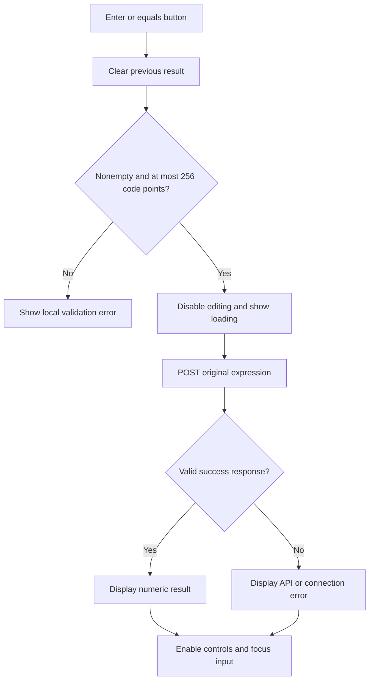

# Frontend implementation and review guide

This document explains the current implementation so its behavior and design choices can be reviewed before further changes. The React frontend is already implemented; the alternatives listed here are review options, not changes that have been made.

## Responsibility and boundaries

The frontend lets a user edit an expression, submit it, and understand the result or error. Go owns parsing, precedence, parentheses, and arithmetic. React sends the original input unchanged and never calculates a result locally.

For example, entering `2+3+5/4` sends:

```json
{"expression":"2+3+5/4"}
```

A successful response is:

```json
{"result":6.25}
```

The full request/error contract is in [API.md](API.md).

## File structure

| File | Responsibility |
| --- | --- |
| [main.tsx](../frontend/src/main.tsx) | Mounts React and imports CSS. Uses React StrictMode during development. |
| [App.tsx](../frontend/src/App.tsx) | Renders the page, owns UI state, validates basic input, handles submission, keypad editing, and focus. |
| [calculator.ts](../frontend/src/api/calculator.ts) | Makes HTTP requests, validates responses, translates errors, and enforces a timeout. |
| [styles.css](../frontend/src/styles.css) | Defines colors, typography, layout, keypad appearance, focus styles, and responsive breakpoints. |
| [vite.config.ts](../frontend/vite.config.ts) | Configures React, the development API proxy, and Vitest/coverage. |
| [App.test.tsx](../frontend/src/App.test.tsx) | Tests form behavior and interactions. |
| [calculator.test.ts](../frontend/src/api/calculator.test.ts) | Tests API request/response handling and failures. |

## State model

All application state is local to `App`; nothing is persisted across reloads.

| Value | Meaning | Initial value |
| --- | --- | --- |
| `expression` | The exact text in the input, including spaces. | Empty string |
| `result` | Last successful numeric result; `null` means no result. | `null` |
| `error` | A `CalculationError` containing a message and optional position. | `null` |
| `pending` | Whether a request is in progress; drives disabled/loading UI. | `false` |

`result !== null` is checked explicitly so a valid answer of zero is displayed.

Two refs support interaction without being display state: `input` points to the native input for selection/focus; `inFlight` is an immediate duplicate-submission guard. Unlike a state update, changing that guard does not wait for React to render.

## Submission lifecycle



Both Enter in the input and the `=` button submit the same native form. There are no separate calculation paths for keyboard and mouse.

Before a request, the frontend checks only:

1. The expression is not empty or whitespace-only.
2. Its length is at most 256 Unicode code points, including whitespace.

The whitespace check uses a trimmed copy, but the submitted value is not trimmed. Go remains responsible for the complete grammar and all arithmetic/domain checks. This avoids maintaining two parsers with potentially different behavior.

During a request, the input, keypad, and example button are disabled. The result area shows “Working…”. A `finally` block clears the pending state and duplicate-submission guard after success or failure.

Editing the expression clears the previous result and error, so an answer never appears to belong to newly edited input.

## Keypad and editing behavior

The keypad is an input aid. It does not call the API except when `=` submits the form.

- Numbers, operators, decimal points, and parentheses insert at the input cursor or replace selected text.
- The visible `×`, `÷`, and `−` buttons insert the API grammar's `*`, `/`, and `-` characters.
- Backspace removes selected text or the previous whole Unicode code point.
- Clear empties the expression, result, and error, then focuses the input.
- The example button fills `(2 + 3) * 4`; it does not calculate automatically. It is hidden in the compact mobile layout.
- After keypad editing, `requestAnimationFrame` restores the cursor after React has updated the controlled input.

Physical-keyboard entry uses the browser's normal input behavior. There are no global keyboard shortcuts, automatic multiplication, bracket completion, or automatic reuse of the previous answer. The submitted expression stays in the field after success.

## API client behavior

`calculate(expression): Promise<number>` is the boundary between UI and HTTP. It:

1. Sends `POST /api/v1/calculate` with JSON and the original expression.
2. Starts an `AbortController` timer lasting ten seconds, covering the request and response-body reading.
3. Parses the JSON as unknown runtime data rather than trusting a TypeScript type.
4. Accepts success only when `result` is a finite number.
5. Converts server and transport failures into `CalculationError` objects.
6. Clears the timer when the request finishes. Requests are not retried automatically.

| Situation | Current UI behavior |
| --- | --- |
| Structured API error | Display the server's nonempty message and valid optional position. |
| Error position is malformed or outside the input | Ignore the position; retain the message. |
| Error response has no usable message | Display a generic request-failure message. |
| Failed HTTP response is not JSON, such as a proxy error | Display a service-unavailable message. |
| Successful HTTP response is not JSON | Display an unreadable-response message. |
| Success result is missing, nonnumeric, or non-finite | Display an invalid-result message. |
| Fetch fails to connect | Display a connection message with a backend-startup hint. |
| Ten-second timeout | Abort and display a timeout message. |

The client currently uses the server message and position, not its error code, to drive presentation. Adding different UI actions for particular error codes would require retaining those codes in `CalculationError`.

## Error positions and accessibility

The API reports zero-based code-point offsets. The UI shows a one-based position: API position `2` appears as “Check position 3.” If it points past the final character, the message identifies the end of the expression.

For `10/(3-3)`, the API identifies `/` at offset `2`. The UI focuses the input and selects that character. Native browser selections use UTF-16 offsets, so the UI converts the API offset before selecting. This matters when an invalid Unicode character occupies more than one UTF-16 unit.

The form has an associated input label, linked help/error text, `aria-invalid`, and `aria-busy`. Results use a polite live region; errors use an alert. Keypad buttons have names such as “Multiply” and “Open parenthesis”. Keyboard focus styles are visible, and focus returns to the input after a result or error. These are implemented accessibility provisions, not a claim of a complete assistive-technology audit.

## Visual design and responsiveness

The current appearance is an implementation choice: a warm neutral background, dark green result panel, and terracotta equals button. Desktop uses an introduction beside the calculator. At widths up to 760px, the layout stacks and hides the supplementary example/hint; additional sizing rules apply at 1000px and 380px.

Styling uses plain CSS. DM Sans and Manrope load from Google Fonts with local sans-serif fallbacks. Reduced-motion preferences disable CSS transitions. Desktop and 320px layouts were checked visually, with no horizontal overflow at 320px.

Review screenshots: [desktop](screenshots/desktop.png) and [mobile](screenshots/mobile.png).

## Development and deployment

Vite serves the frontend on `127.0.0.1:5173` and proxies `/api` to `127.0.0.1:8080`. `API_PROXY_TARGET` overrides the backend target. This keeps browser requests on one origin during development.

The production build outputs static assets to `frontend/dist/`. Production hosting still needs to serve those assets and route `/api` to Go; local integration does not establish a deployed production setup. Run/build commands are in the [README](../README.md).

## Patterns and tradeoffs

The implementation uses a **controlled form**, **local React state**, and a separate **API client module**. It does not require a global state manager or a frontend copy of the backend Interpreter pattern.

Keeping the page in one component is simple for this scope, but `App.tsx` currently combines page presentation, state, and input-editing behavior. If more features are planned, extracting `CalculatorForm`, `Keypad`, `ResultPanel`, and a `useCalculator` hook would make those responsibilities easier to navigate. Those extractions have not been made.

## Choices to review before further changes

| Choice | Current behavior | Possible alternative |
| --- | --- | --- |
| Page layout | Introduction plus calculator on desktop | Calculator-only layout |
| Input controls | Free-text expression and keypad | Keyboard-first form with fewer buttons |
| Submission | Explicit Enter or `=` | Debounced live calculation, with cancellation/stale-response handling |
| Pending requests | Disable editing until completion | Allow edits; cancel/ignore superseded requests |
| Result formatting | `String(result)`, preserving normal floating-point artifacts | Rounded display with a separately accessible precise value |
| Next calculation | Original expression remains in the field | Replace input with the answer or offer an explicit “Use result” action |
| Error feedback | Server message, position, and selected character | Inline annotated expression or field-specific guidance |
| Appearance | Current colors, typography, and introduction copy | Different theme, copy, or self-hosted fonts |
| Component organization | One page component plus an API module | Smaller UI components and a state hook |

## Verification and limits

The last implementation run passed 26 client/component tests, TypeScript checks, and the production build. Reported statement coverage was 97.89%, with 93.26% branch coverage. Tests control fetch responses; separate manual browser checks used the real Go API for precedence, parentheses, division errors, Clear, and outage/recovery behavior.

Tested responsive widths were desktop and 320px. This does not establish support across every browser/device or a full screen-reader audit. Optional advanced operations, persistent history, and production deployment are outside the current implementation.
